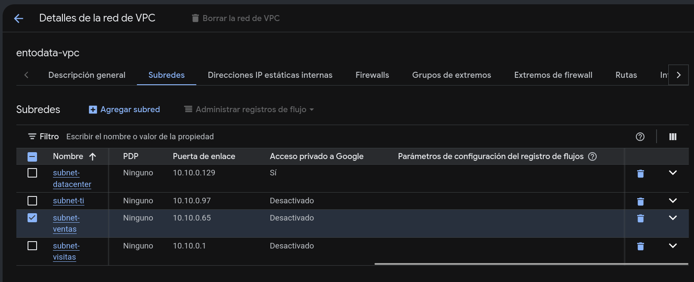
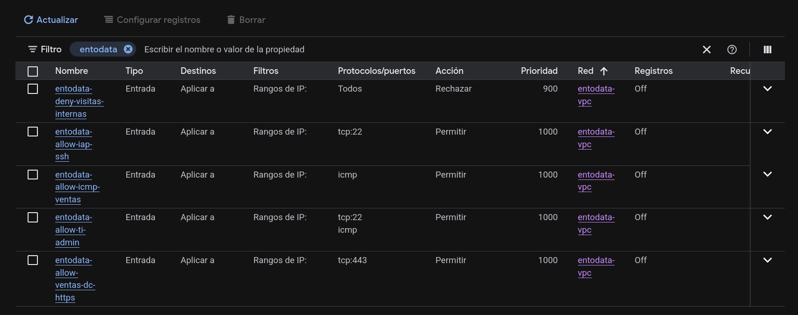
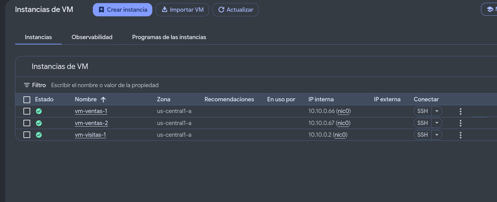

# EntoData — Proyecto Final Redes, Fase 1

Diseño, subneteo e implementación base en la nube (Google Cloud Platform).
Autor: Juan Fernando Menéndez Guerra (17444) — CC3067 Redes, UVG.

## Diseño implementado

Bloque base `10.10.0.0/24`, VPC `entodata-vpc` en modo personalizado, región `us-central1`.
GCP reserva 4 direcciones por subred (red, gateway, penúltima y broadcast); por eso el Data Center usa /28 y no /29.

| Subred | CIDR | Gateway | Rango usable | Hosts requeridos |
|---|---|---|---|---|
| subnet-visitas | 10.10.0.0/26 | 10.10.0.1 | .2 – .61 (60) | 50 visitantes |
| subnet-ventas | 10.10.0.64/27 | 10.10.0.65 | .66 – .93 (28) | 25 personas |
| subnet-ti | 10.10.0.96/27 | 10.10.0.97 | .98 – .125 (28) | 15 personas |
| subnet-datacenter | 10.10.0.128/28 | 10.10.0.129 | .130 – .141 (12) | 5 servidores |

Reglas de firewall (ingress). Además aplican las implícitas de GCP: *deny all ingress* y *allow all egress*.

| Regla | Origen | Destino | Protocolo | Acción | Prioridad |
|---|---|---|---|---|---|
| entodata-deny-visitas-internas | 10.10.0.0/26 | Ventas, TI, DC | todos | DENY | 900 |
| entodata-allow-icmp-ventas | 10.10.0.64/27 | 10.10.0.64/27 | ICMP | ALLOW | 1000 |
| entodata-allow-ti-admin | 10.10.0.96/27 | toda la VPC | ICMP, TCP 22 | ALLOW | 1000 |
| entodata-allow-ventas-dc-https | 10.10.0.64/27 | 10.10.0.128/28 | TCP 443 | ALLOW | 1000 |
| entodata-allow-iap-ssh | 35.235.240.0/20 | toda la VPC | TCP 22 | ALLOW | 1000 |

VMs de prueba: tipo e2-micro con Debian 12, **sin IP pública** (el acceso es por SSH a través de Google IAP).

| VM | Subred | IP |
|---|---|---|
| vm-ventas-1 | subnet-ventas | 10.10.0.66 |
| vm-ventas-2 | subnet-ventas | 10.10.0.67 |
| vm-visitas-1 | subnet-visitas | 10.10.0.2 |

## Estructura

```
infra/gcp/   scripts gcloud (ejecutar en orden)
config/      configuración real exportada de GCP (YAML + resumen.txt)
evidencias/  salidas de las pruebas de conectividad
docs/        enunciado y reporte
```

## Uso

Requisitos: tener Google Cloud CLI con `gcloud auth login` hecho y un proyecto con facturación habilitada.
El ID del proyecto va en `.env`, que no se versiona.

```bash
cp .env.example .env               # y poner el PROJECT_ID propio
./infra/gcp/01-habilitar-apis.sh
./infra/gcp/02-red.sh
./infra/gcp/03-firewall.sh
./infra/gcp/04-instancias.sh
./infra/gcp/05-pruebas.sh          # deja las salidas en evidencias/
./infra/gcp/06-exportar-config.sh  # deja la configuración en config/
./infra/gcp/97-encender.sh         # enciende las VMs (para demos posteriores)
./infra/gcp/98-apagar.sh           # detiene las VMs al terminar
./infra/gcp/99-eliminar.sh         # borra todo (pide confirmación)
```

Todos los scripts son idempotentes: si un recurso ya existe, no lo vuelven a crear.
La guía paso a paso para la presentación está en [TUTORIAL.md](TUTORIAL.md).

## Resultados

- `vm-ventas-1 → vm-ventas-2`: 4/4 paquetes, 0 % de pérdida ([evidencia](evidencias/03-ping-ventas1-a-ventas2.txt))
- `vm-ventas-2 → vm-ventas-1`: 4/4 paquetes, 0 % de pérdida ([evidencia](evidencias/04-ping-ventas2-a-ventas1.txt))
- `vm-visitas-1 → vm-ventas-1`: 0/4 paquetes, 100 % de pérdida, bloqueado por la segmentación ([evidencia](evidencias/06-ping-visitas-a-ventas.txt))

## Capturas de la consola de GCP

**Subredes de `entodata-vpc`** con sus puertas de enlace y el acceso privado a Google. Los rangos de IP de cada subred están en [config/subredes.yaml](config/subredes.yaml).



**Reglas de firewall de la VPC.** Los rangos de origen y destino de cada regla están en [config/firewall.yaml](config/firewall.yaml).



**Instancias de prueba** con su IP interna fija y sin IP externa.


